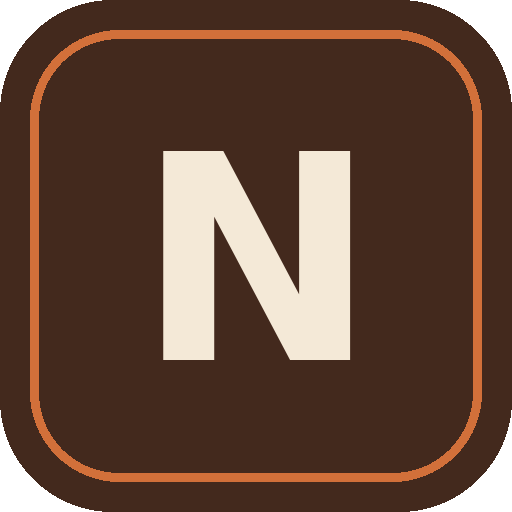

<div align="center">



# Notoo

**Notes & Canvas — a fast, offline notes app with a real infinite canvas.**

[](https://github.com/itsrawdevvvvvv-arch/Notoo/actions/workflows/android.yml)
[](https://www.gnu.org/licenses/gpl-3.0)

[**⬇️ Download the APK**](../../releases/latest) · [**🌐 Try it in your browser**](https://itsrawdevvvvvv-arch.github.io/Notoo/)

</div>

---

## Download

Grab the latest build from the [**Releases page**](../../releases/latest):

| File | What it is |
|---|---|
| `Notoo-app-release.apk` | Install this one. Signed with the standard Android debug key so it can be side-loaded. |
| `Notoo-app-debug.apk` | Debug build. Installs alongside the release build under a separate package name. |

**To install:** open the `.apk` on your phone and allow installing from your browser when
prompted (*Settings → Apps → Special access → Install unknown apps*). Android may warn that
the app is from an unknown developer — that is expected for any app installed outside the
Play Store.

You can also just open the [web version](https://itsrawdevvvvvv-arch.github.io/Notoo/) — it is
the exact same app, and it installs to your home screen as a PWA (Add to Home screen) and works
offline.

---

## What it does

**Notes**
- Rich text: bold, italic, underline, headings, lists, checklists, quotes, links, images
- Markdown-style typing: `-` bullet, `1.` numbered, `#` heading, `>` quote, `[]` task
- Pin, star, colour, tag, and a due date with overdue badges
- Type `#anything` in a note and it becomes that note's tag automatically
- Archive (separate from Trash), search, sort, grid/list layout
- Read aloud, print / save as PDF, export as a PNG, JSON backup and restore

**Canvas**
- A genuinely infinite board: pan, pinch-zoom, endless moving background
- Text, sticky notes, images, 9 shapes, and freehand pen drawing
- Move, resize, rotate, lock, duplicate and re-order anything
- 12 background colours × 7 textures (dots, grid, ruled, graph, isometric…)
- Alignment guides that snap objects into line as you drag
- Undo / redo, fit-to-screen, export the whole board as a PNG

**The rest**
- **36 fonts** to choose from — app-wide, per note, or per canvas object
- Four screen transitions + a reduce-motion switch
- Light, dark, sepia themes and six accent colours
- Command palette (Ctrl/⌘ + K) and keyboard shortcuts
- Works fully offline; all data stays on your device

---

## Running it

It is a single self-contained HTML file. Nothing to build.

```bash
git clone https://github.com/itsrawdevvvvvv-arch/Notoo.git
cd Notoo
# any static server works
python3 -m http.server 8080
# then open http://localhost:8080
```

Opening `index.html` directly from disk also works; only the offline
service worker needs a real server.

## Building the APK

The Android app is a thin native shell that loads the web app from
`assets/index.html`, so there is no separate UI to maintain.

```bash
# bundle the web app into the Android project
mkdir -p android/app/src/main/assets
cp index.html android/app/src/main/assets/index.html

cd android
gradle assembleDebug      # or assembleRelease
```

Requires JDK 17 and the Android SDK. Pushing a tag (`git tag v1.0.0 && git push --tags`)
makes GitHub Actions build both APKs and attach them to the release automatically.

## Project layout

```
index.html                  the entire app (HTML + CSS + JS, no build step)
manifest.webmanifest        PWA manifest
sw.js                       service worker for offline use
icon-*.png, icon.svg        app icons
android/                    Android WebView wrapper
.github/workflows/          APK build + release pipeline
```

## Notes and limitations

- Everything is stored in your browser's / WebView's local storage. There is no account and
  no sync. Use **Profile → Export all notes** to back up.
- Storage is limited to roughly 5 MB, so images are downscaled on insert.
- The release APK is signed with a debug key for easy side-loading. Generate your own keystore
  before distributing through an app store.
- The 36 fonts load from Google Fonts the first time you open the font picker. Offline, the app
  falls back to the system font — everything else works normally.

## A note on this repository

`main` now holds **Notoo for the web / Android** — the single-file app described above.

An earlier Flutter build of Notoo lived on `main`. It has been preserved in full on the
[`flutter-legacy`](../../tree/flutter-legacy) branch, so nothing was lost. If you want that
version back, check out that branch.

## License

[MIT](LICENSE).
